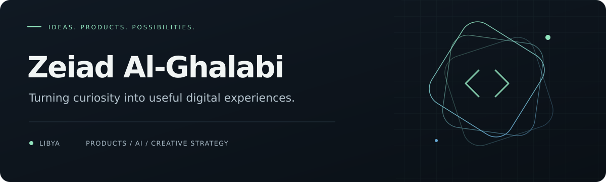

  

  <strong>Digital products &nbsp;·&nbsp; Creative strategy &nbsp;·&nbsp; Applied AI</strong>

 

### A little about me

I'm Zeiad, based in Libya. My work brings together creative thinking, digital products, and an interest in how technology can solve everyday problems.

I work across content, brand communication, and product development, exploring how AI can help turn an idea into something useful.

### What interests me

| Digital products | Practical AI | Creative work |
| :--- | :--- | :--- |
| Clear experiences built around real needs. | Tools and workflows that make useful work easier. | Content, visual communication, and meaningful brands. |

### How I approach work

- Start with the problem and understand who it affects.
- Make the experience clear, useful, and thoughtful.
- Learn by building, testing, and improving.
- Bring creative and technical perspectives together.

 

  Curious by nature. Thoughtful about what comes next.

